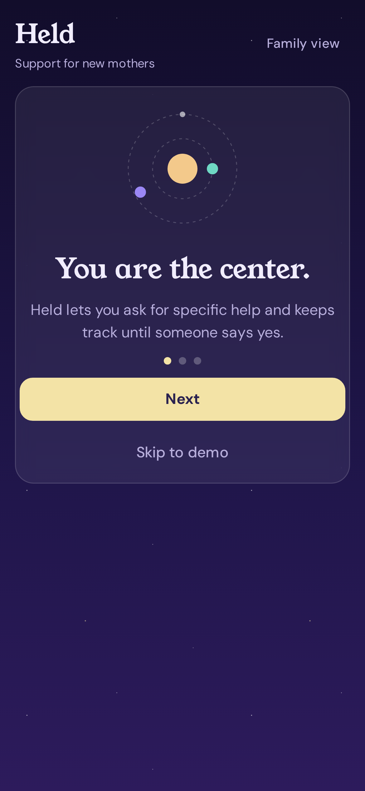
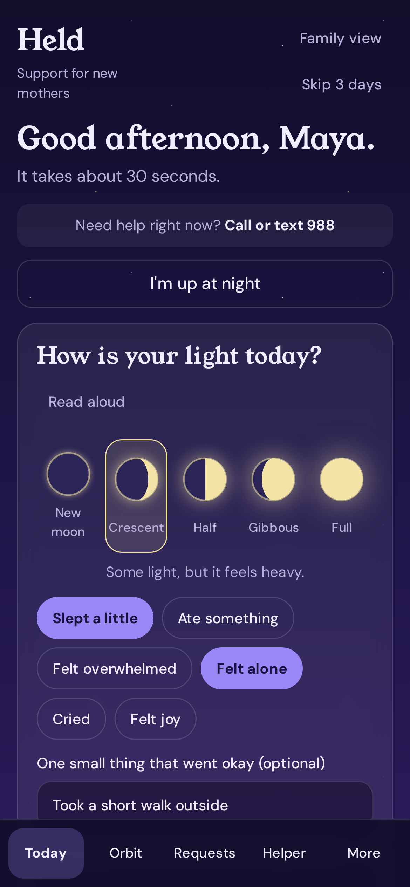
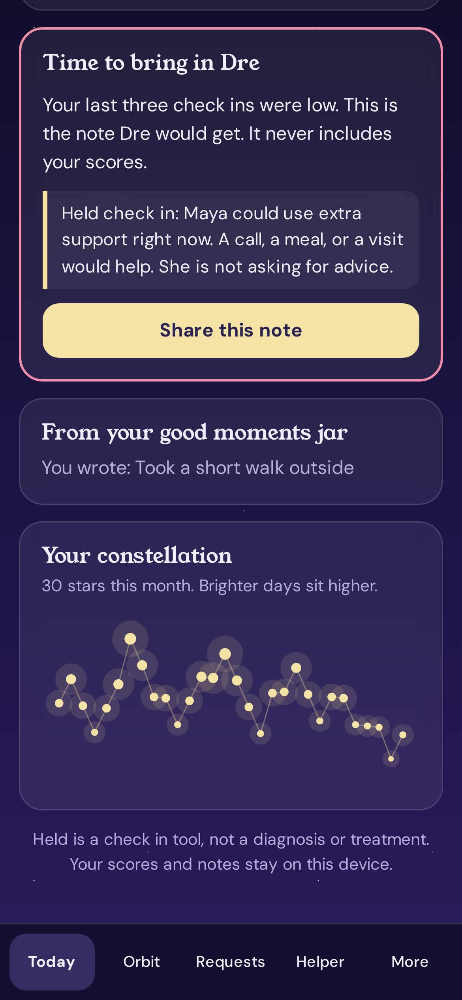

# Held

**Mothers deserve to be held too**

**Live demo:** https://heldmothers.netlify.app/  
**Status:** Hackathon build · **Built at:** Hacklanta 2026

   

## Overview
A support app for new mothers that turns “let me know if you need anything” into specific help. She checks in with a moon phase, asks for something concrete like dinner, a nap or a phone call, and family claims it from a link with no account. Held tracks every ask until it is done, nudges late claims, and notices when she may be struggling. Her scores and notes never leave her phone.

## What I built
Moon check ins that grow into a 30 day constellation; requests family claim from a link, with late claims turning rose and a one tap nudge; an orbit view where she is the planet and the people who said yes are moons; a wellness check that prepares a note to her chosen person after 3 low check ins or 2 quiet days, without her scores; Held Helper, where Gemini turns her words into up to two asks from a fixed list and drafts the message, with a crisis guard that runs before any AI call and shows 988 and the postpartum line; a night mode with a breathing guide and ElevenLabs voice; a family view, guided tour, undo, doctor visit summary and install to the home screen. Supabase tables are locked so the browser only calls named functions, and Auth0 lets her reopen her circle on any phone.

## My role
Product lead and builder on a Hacklanta 2026 team: concept, UX flows, front end, Supabase schema and AI guardrails.

## Security and privacy
* A crisis guard runs before every AI call and shows the 988 and postpartum hotline numbers instead of an AI reply.
* Supabase tables are locked with row level security. The browser can only call named SQL functions, and circles are reached by an unguessable id.
* The Supabase **anon** key in `index.html` is a public key by design. It can only do what the row level security policies allow. The Gemini and ElevenLabs keys live in Supabase secrets, never in the browser.
* Her mood scores and notes stay on her phone. Family sees the asks, not the data.

## Tech
HTML, CSS, JavaScript, Supabase (Postgres, Edge Functions), Gemini API, ElevenLabs, Auth0, Netlify

## Run it
Open `index.html` in a browser to run it in demo mode. See [SETUP.md](SETUP.md) to connect Supabase, the Edge Functions and Auth0.

## What's next
Clinician and doula review of all wording, partnerships with maternal health groups and clinics, push reminders with quiet hours, and more languages.

---
Built by **Taseyana Booker-Hopkins** · Computer Information Systems (cybersecurity), Georgia State University · [Portfolio](https://taseyanab.github.io) · [LinkedIn](https://linkedin.com/in/taseyana)
